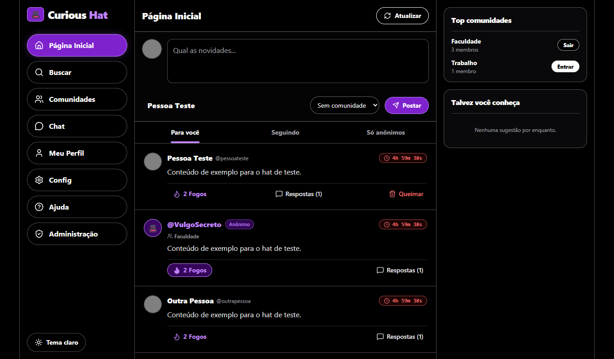
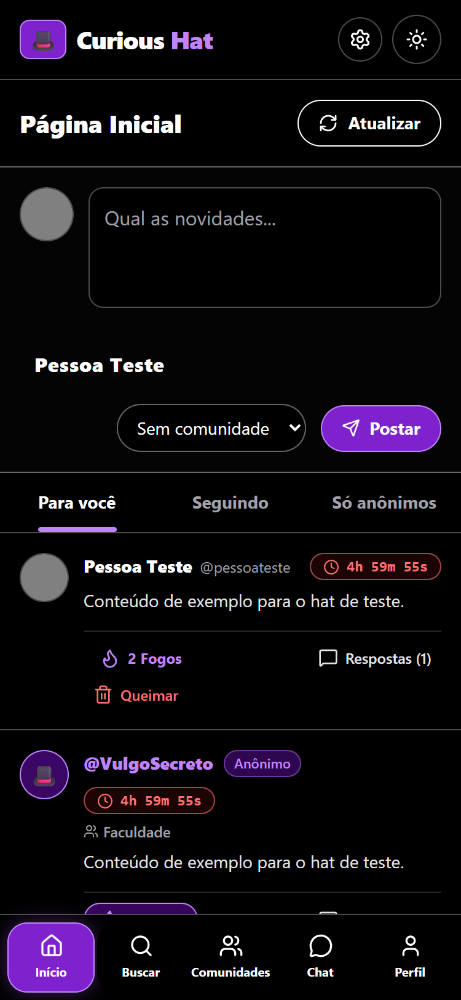

# Curious Hat

> A social network where every post is your call: sign it with your name, or wear the hat and post anonymously for 24 hours, with privacy enforced by the database rather than the UI.


<div align="center">




*Screens shown with sample data.*

**[🚀 View Live Demo](https://curious-hat-app-nu.vercel.app) • [🐛 Report Bug](https://github.com/Luan-Neumann-Dev/curious-hat-app/issues)**

</div>

---

## 📋 Table of Contents

- [About The Project](#-about-the-project)
- [Features](#-features)
- [Tech Stack](#-tech-stack)
- [Getting Started](#-getting-started)
- [Project Structure](#-project-structure)
- [Architecture](#-architecture)
- [Database Schema](#-database-schema)
- [API Documentation](#-api-documentation)
- [Challenges & Solutions](#-challenges--solutions)
- [Accessibility](#-accessibility)
- [Security](#-security)
- [What I Learned](#-what-i-learned)
- [Roadmap](#-roadmap)
- [Author](#-author)

## 🎯 About The Project

Curious Hat is a social network built around one decision: for each post, called a *hat*, you choose whether it carries your name or an anonymous codename. Signed hats stay on your profile. Anonymous hats show only your codename and disappear after 24 hours, unless you add a few more minutes.

Anonymity is only worth something if it holds up against a curious user with the browser's network tab open. So the rules live in PostgreSQL instead of the front end: the tables that know who wrote a hat can't be read by other users, and everyone reads through views that remove the author from anonymous content. Even administrators can moderate anonymous hats without being able to see who wrote them.

The app is a React and TypeScript single-page application that talks to Supabase over its REST API, with Supabase Auth for accounts, Storage for images and Realtime for chat. The interface is in Brazilian Portuguese and is responsive from phones to desktops.

### Why I Built This

Curious Hat started as a university assignment: a responsive web application with several screens, form validation, a consumed REST API with proper error handling, WCAG AA accessibility and a production deploy. It grew into a chance to design real authorization rules, moving the original prototype from browser storage and JavaScript to a typed front end backed by a real database.

## ✨ Features

### Core Functionality

- 🎩 **Signed or anonymous hats** - Choose an identity per post; anonymous hats show only your codename
- ⏳ **Self-destructing posts** - Anonymous hats expire after 24 hours with a live countdown, and the author can add 5 minutes at a time
- 🔥 **Fogos and replies** - Like hats with a *Fogo* and answer them, signed or anonymously
- 👥 **Communities** - Join topic communities, post in them and talk in their group chat
- 💬 **Real-time chat** - Direct, anonymous and community conversations, delivered live
- 🔍 **Search** - Find people, hats and communities, with a ranking of the most liked hats
- 🛡️ **Admin panel** - Totals, content moderation and user blocking, without access to anonymous authors

### User Experience

- Feed tabs for *For you*, *Following* and *Anonymous only*
- Profiles with hats, liked hats, communities, followers and following
- Follow suggestions and a top communities side panel
- Light and dark themes, with the choice remembered between visits
- Settings for anonymous-by-default posting, accepting anonymous chats and showing counts
- Registration form with field-level validation and profile and cover images, compressed in the browser before upload
- Help page explaining how anonymity works

### Technical Features

- Row Level Security on every table, plus column-level write permissions
- Service layer that turns API failures into clear messages in Portuguese
- Optimistic like button that falls back to the server's count
- Separate layouts for phone, tablet and desktop, with no horizontal scrolling from 320 px to 1920 px

## 🧰 Tech Stack

**Frontend:**

- React 19 - User interface
- TypeScript 7 - Static typing
- React Router 7 - Client-side navigation
- Tailwind CSS 4 - Styling and light and dark theme tokens
- Lucide React - Icons

**Backend (Supabase):**

- PostgreSQL - Data, views, triggers, functions and Row Level Security
- Supabase Auth - Email and password accounts
- Supabase Storage - Profile and cover images
- Supabase Realtime - Live chat messages
- supabase-js 2 - Client for the REST API

**DevOps:**

- Vercel - Hosting for the front end

**Development Tools:**

- Vite 8 - Dev server and build
- Oxlint - Linting

## 🚀 Getting Started

### Prerequisites

- Node.js 20.19+ or 22.12+
- A free [Supabase](https://supabase.com) project

### Installation

1. **Clone the repository**

```bash
git clone https://github.com/Luan-Neumann-Dev/curious-hat-app.git
cd curious-hat-app
```

2. **Set up the database**

In the Supabase SQL Editor, run the files in `supabase/migrations` in order, from `001` to `004`.

3. **Turn off email confirmation**

In Supabase, go to **Authentication** and disable **Confirm email**.

4. **Configure the environment**

```bash
cp .env.example .env.local
```

Fill in `.env.local` with your project's URL and publishable key. Never use the secret or `service_role` key here.

```env
VITE_SUPABASE_URL=https://YOUR-PROJECT.supabase.co
VITE_SUPABASE_PUBLISHABLE_KEY=sb_publishable_YOUR_KEY
```

5. **Install and run**

```bash
npm install
npm run dev
```

The app will be available at `http://localhost:5173`.

### Available Commands

| Command | Description |
| --- | --- |
| `npm run dev` | Starts the development server |
| `npm run build` | Checks types and builds for production |
| `npm run typecheck` | Only checks types |
| `npm run lint` | Runs the linter |
| `npm run preview` | Serves the production build locally |

### Optional Scripts

Run these in the Supabase SQL Editor:

| Script | Description |
| --- | --- |
| `supabase/tornar-admin.sql` | Makes an account an administrator |
| `supabase/dados-demonstracao.sql` | Creates demo content for three test accounts, replacing what those accounts have already posted |
| `supabase/limpar-contas-teste.sql` | Removes test accounts |

## 📁 Project Structure

```
curious-hat-app/
├── public/                # Static files
├── src/
│   ├── components/        # Reusable UI and layout
│   │   └── profile/       # Profile view and form
│   ├── hooks/             # Data and announcement hooks
│   ├── lib/               # Supabase client and helpers
│   ├── pages/             # Screens
│   ├── services/          # API access, grouped by domain
│   ├── types/             # Shared types
│   ├── App.tsx            # Session and entry screens
│   └── index.css          # Theme tokens
├── supabase/
│   ├── migrations/        # Schema, rules and functions
│   └── *.sql              # Admin and demo scripts
├── index.html
├── vercel.json            # SPA rewrites
└── vite.config.ts
```

## 🧱 Architecture

The browser talks directly to Supabase. There is no custom server: authorization is enforced by PostgreSQL on every request, based on the signed-in user's token.

```
Page / Component → Service → supabase-js → Supabase REST API → PostgreSQL (RLS, views, functions)
                                         → Supabase Realtime → Live chat messages
```

### Design Patterns Used

- **Service layer** - Pages never call Supabase directly; `src/services` hides table names and translates errors
- **Read views** - Other users read from `hats_public` and `replies_public`, never from the base tables
- **Server-side rules in triggers** - Codenames and expiration dates are set by the database, so a client can't forge them
- **Security-definer functions** - Sensitive actions like deleting a hat or blocking a user go through functions with their own checks
- **Custom hooks** - `useCommunities` and `useProfileData` share data loading between screens

## 💾 Database Schema

### Tables

| Table | Purpose |
| --- | --- |
| `profiles` | Public profile, role and blocked status |
| `profile_private` | Full name, birth date, codename and preferences, readable only by the owner |
| `follows` | Who follows whom |
| `communities` | Topic communities |
| `community_members` | Community membership |
| `hats` | Posts, with anonymity flag and expiration date |
| `replies` | Replies to hats |
| `likes` | Fogos given to hats |
| `conversations` | Direct, anonymous and group conversations |
| `conversation_members` | Conversation participants |
| `messages` | Chat messages, linked to a participant rather than a person |

### Public Views

| View | Purpose |
| --- | --- |
| `hats_public` | Live hats with the author hidden on anonymous ones, plus counts |
| `replies_public` | Replies to live hats with anonymous authors hidden |
| `conversation_members_public` | Participants, hiding the identity of anonymous ones |
| `conversations_overview` | Each user's conversations with their last message |

### Relationships

```
profiles (1) ──→ (1) profile_private
profiles (1) ──→ (N) hats
profiles (1) ──→ (N) replies
profiles (N) ←─→ (N) profiles            via follows
profiles (N) ←─→ (N) communities         via community_members
profiles (N) ←─→ (N) hats                via likes
profiles (N) ←─→ (N) conversations       via conversation_members
communities (1) ──→ (N) hats
communities (1) ──→ (1) conversations    group chat
hats (1) ──→ (N) replies
conversation_members (1) ──→ (N) messages
```

## 📚 API Documentation

The app consumes the REST API that Supabase generates from the database. Except for sign-up and sign-in, every request needs a signed-in user's token. Failed responses are handled in `src/services` and shown to the user as a message.

### Main Endpoints

| Method | Endpoint | Description |
| --- | --- | --- |
| POST | `/auth/v1/signup` | Create an account |
| POST | `/auth/v1/token?grant_type=password` | Sign in |
| GET | `/rest/v1/hats_public` | List and search hats |
| POST | `/rest/v1/hats` | Publish a hat |
| POST | `/rest/v1/rpc/delete_hat` | Delete a hat |
| POST | `/rest/v1/rpc/extend_hat` | Add 5 minutes to an anonymous hat |
| GET | `/rest/v1/replies_public` | List replies |
| POST | `/rest/v1/replies` | Reply to a hat |
| POST | `/rest/v1/likes` | Give a Fogo |
| DELETE | `/rest/v1/likes` | Remove a Fogo |
| GET | `/rest/v1/profiles` | Read and search profiles |
| PATCH | `/rest/v1/profiles` | Update a profile |
| PATCH | `/rest/v1/profile_private` | Update private data and preferences |
| POST | `/rest/v1/follows` | Follow someone |
| DELETE | `/rest/v1/follows` | Unfollow someone |
| GET | `/rest/v1/communities` | List and search communities |
| POST | `/rest/v1/community_members` | Join a community |
| DELETE | `/rest/v1/community_members` | Leave a community |
| GET | `/rest/v1/conversations_overview` | List conversations |
| POST | `/rest/v1/rpc/start_direct_chat` | Start a direct chat |
| POST | `/rest/v1/rpc/start_anonymous_chat` | Start an anonymous chat |
| GET | `/rest/v1/messages` | Read messages |
| POST | `/rest/v1/messages` | Send a message |
| POST | `/rest/v1/rpc/admin_stats` | Read admin totals |
| POST | `/rest/v1/rpc/admin_set_blocked` | Block or unblock a user |

### Example Request

```bash
curl "https://YOUR-PROJECT.supabase.co/rest/v1/hats_public?select=*&order=created_at.desc&limit=10" \
  -H "apikey: YOUR_PUBLISHABLE_KEY" \
  -H "Authorization: Bearer USER_ACCESS_TOKEN"
```

## 💡 Challenges & Solutions

### Challenge 1: Anonymity That Survives the Network Tab

**Problem:** Hiding the author in the UI isn't enough. If the API returned the author's ID, anyone could read it in the browser and link an anonymous post to a person.

**Solution:** Base tables can only be read by the post's own author. Everyone else reads a view that blanks out identifying columns whenever a hat is anonymous.

```sql
create view public.hats_public as
select
  h.id,
  case when h.is_anonymous then null else h.author_id end as author_id,
  h.is_anonymous,
  h.author_id = auth.uid() as is_mine,
  case when h.is_anonymous then h.codename else p.account_name end as display_name
  -- ...
from public.hats h
join public.profiles p on p.id = h.author_id
where h.expires_at is null or h.expires_at > now();
```

**Result:** The author's identity never leaves the database for anonymous hats, and expired hats disappear from every list without a cleanup job.

### Challenge 2: Real-Time Chat Without Leaking Identities

**Problem:** Realtime broadcasts database rows. A `user_id` on each message would reveal who is behind an anonymous conversation.

**Solution:** Messages point to a conversation participant instead of a person, so the broadcast row has nothing that identifies the sender.

```sql
create table public.messages (
  id uuid primary key default gen_random_uuid(),
  conversation_id uuid not null references public.conversations (id) on delete cascade,
  member_id uuid not null,
  content text not null,
  -- ...
  foreign key (member_id, conversation_id)
    references public.conversation_members (id, conversation_id) on delete cascade
);
```

**Result:** Anonymous chats work live, and the composite foreign key also guarantees that a sender belongs to the conversation.

### Challenge 3: Moderation Without Seeing Authors

**Problem:** Administrators must be able to remove abusive hats, but giving them read access to `hats` would expose anonymous authors.

**Solution:** Admins have no special read access. Deleting goes through a function that checks permission, and the dashboard totals come from a function that returns only numbers.

```sql
create function public.delete_hat(alvo uuid) returns void
language plpgsql security definer set search_path = '' as $$
begin
  delete from public.hats
  where id = alvo and (author_id = auth.uid() or public.is_admin());
  if not found then
    raise exception 'Você não pode excluir este hat.' using errcode = '42501';
  end if;
end;
$$;
```

**Result:** Moderation works while anonymous authors stay hidden, even from the people running the platform.

### Challenge 4: Making a Single-Page App Work Without a Mouse

**Problem:** Changing routes in a single-page app doesn't reload the page, so screen readers aren't told about the new screen and keyboard focus can get lost.

**Solution:** The layout updates the document title and moves focus to the main content on every route change.

```tsx
useEffect(() => {
  document.title = tituloDaRota(pathname);
  if (caminhoAnterior.current === pathname) return;
  caminhoAnterior.current = pathname;
  conteudoRef.current?.focus({ preventScroll: true });
}, [pathname]);
```

**Result:** Each screen has its own title, and keyboard users continue from the new content instead of the top of the page.

## ♿ Accessibility

The project targets WCAG 2.1 AA:

- Skip link, landmarks and a unique title on each screen
- Keyboard support, including a focus-trapping dialog and arrow-key navigation in tabs
- Form errors tied to their fields, with focus moved to the first invalid one
- Loading states and search results announced to screen readers through a live region
- Color contrast checked in both light and dark themes
- Autocomplete attributes on personal data fields

### Automated Results

These checks ran locally against a production build with a mocked API:

| Check | Coverage | Result |
| --- | --- | --- |
| Lighthouse accessibility | 12 screens, both themes, mobile and desktop (48 runs) | 100 on every run |
| axe-core, WCAG 2.0 to 2.2 A and AA rules | 68 screen states | 0 violations |
| Horizontal scrolling | 11 signed-in screens at 6 widths, from 320 to 1920 px | None |

Automated tools catch only part of WCAG, so these results don't prove full conformance on their own.

## 🔐 Security

- Row Level Security enabled on every table
- All default Supabase permissions revoked, then granted back table by table and, for writes, column by column
- `role` and `blocked` can't be changed from the client, because neither is among the writable columns
- Blocked users are stopped by the database when they post, reply or send messages
- Security-definer functions run with an empty `search_path`
- Images are uploaded only to the user's own folder, as JPEG, up to 2 MB
- Only the public Supabase key is used in the browser

## 🎓 What I Learned

### Technical Skills

- **Row Level Security:** Treating the database as the real security boundary, rather than the interface
- **PostgreSQL Views and Triggers:** Shaping what each user can see and setting sensitive fields on the server
- **Supabase Realtime:** Designing a schema with what gets broadcast in mind
- **TypeScript Migration:** Moving an existing JavaScript React app to strict types, and splitting large components along the way
- **Web Accessibility:** Applying WCAG in a single-page app, from focus management to live regions

### Best Practices

- Enforcing rules on the server and treating front-end checks as a convenience
- Starting from no permissions and granting only what's needed
- Telling an empty list apart from a failed request, so errors never look like missing data
- Testing with the keyboard, since a perfect Lighthouse score can still hide real barriers

## 🧭 Roadmap

### Future Improvements

- [ ] Automated tests for services and key flows
- [ ] Continuous integration for linting, types and tests
- [ ] Manual testing with screen readers
- [ ] Code splitting to reduce the initial bundle
- [ ] Creating communities from the interface

## 👤 Author

**Luan Neumann**

- 🐱 GitHub: [@Luan-Neumann-Dev](https://github.com/Luan-Neumann-Dev)

Developed together with **Bernardo Teleken Bertolo** ([@bebertolo](https://github.com/bebertolo)), who created the original prototype.

---

<div align="center">

**⭐ Star this repository if you found it helpful!**

</div>
